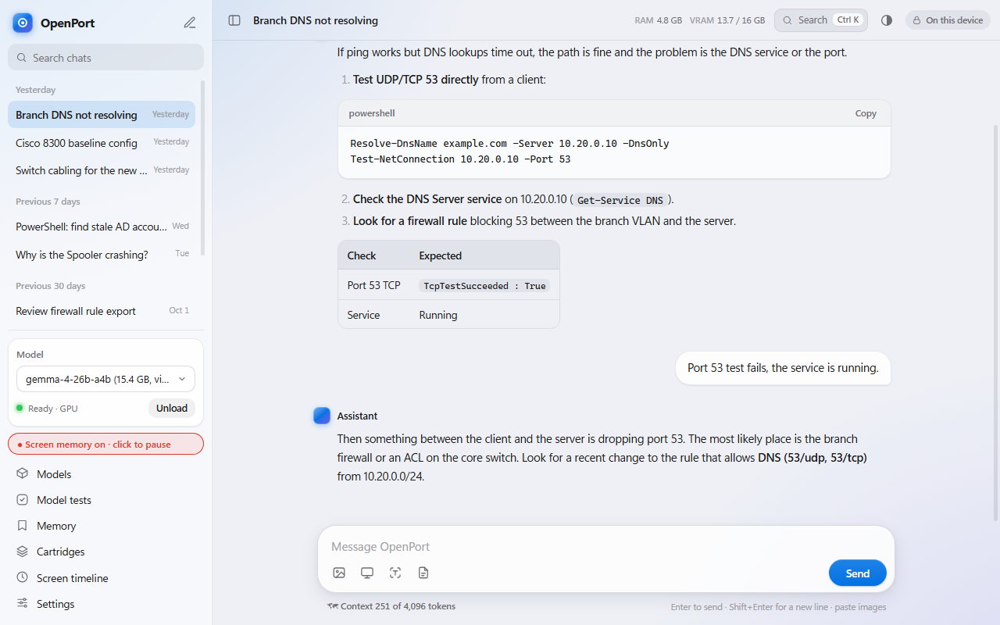
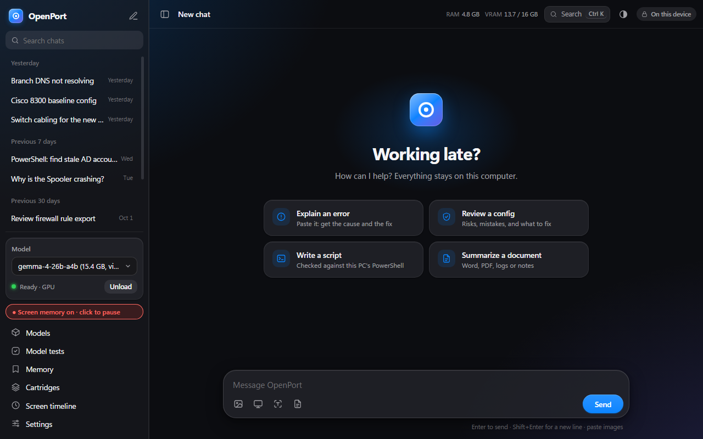
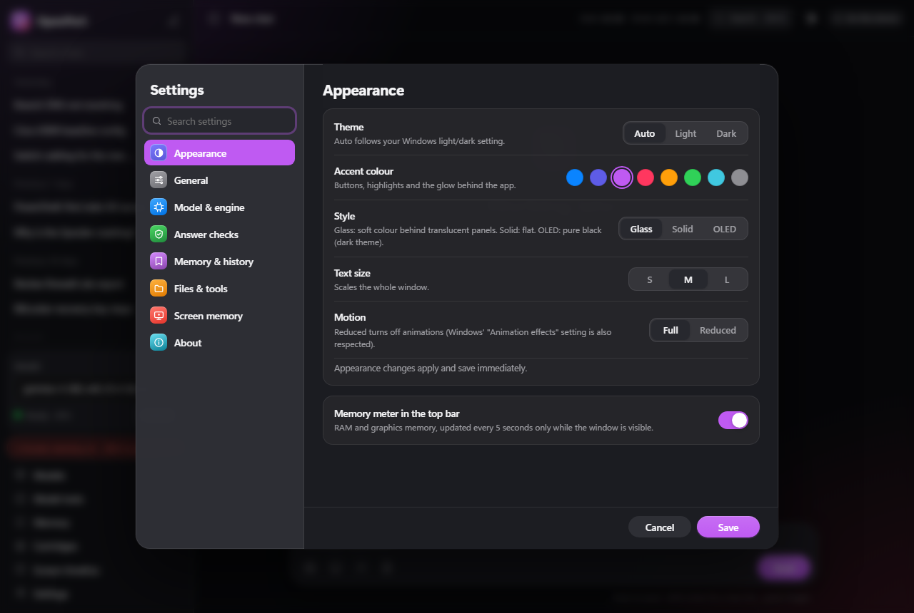
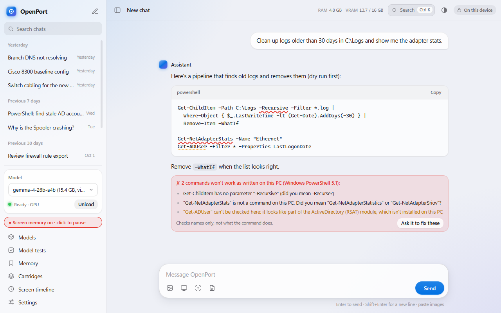
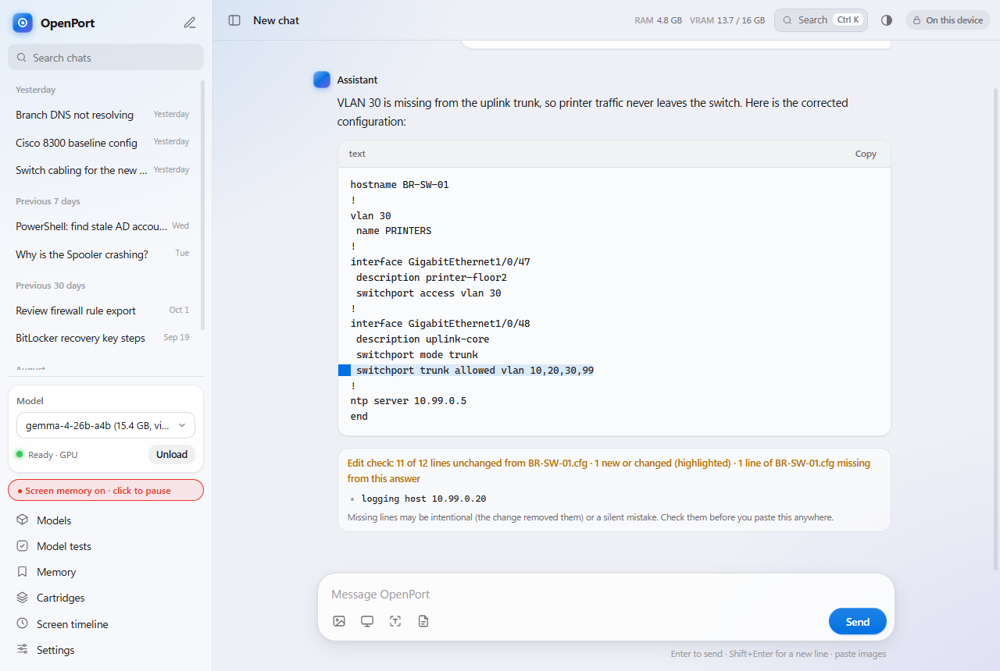
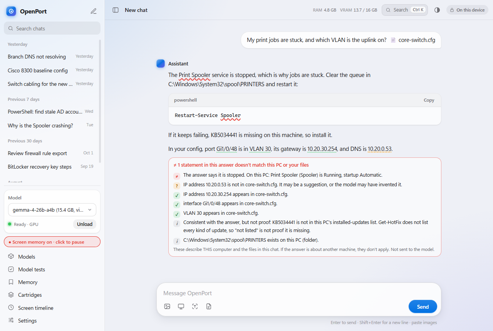

# OpenPort

**A private, portable AI assistant for IT work that runs entirely on your own Windows PC, and checks its own answers.**

OpenPort runs open-source models (Gemma 4 by default) locally through [llama.cpp](https://github.com/ggml-org/llama.cpp).
Your chats, files and configs never leave the machine. It is built for troubleshooting, configs, logs and PowerShell, and it is
built around one idea:

> **Verify, don't trust.** The model writes. OpenPort then checks what it wrote against things it can actually prove
> (your files, your PC's real PowerShell, the real services on the machine) and shows you the result. It never silently
> "fixes" the answer, because a forced correction can be wrong too.



<p align="center">
  
  
</p>

## What makes it different

### 1. Command checker: catches invented PowerShell
Every PowerShell command and parameter in an answer is looked up in **your PC's own PowerShell** (`Get-Command`).
A made-up cmdlet (`Get-NetAdapterStats`) or parameter (`-Recursive`) gets a red underline and a "did you mean" from the real
list. One click drafts a correction request that includes the command's **real** parameters. Only names are looked up:
nothing from the answer is ever executed.



### 2. Edit check: shows exactly what changed, and what silently disappeared
Ask "remove the ACLs from that config" or "fix this script and send it back", and OpenPort compares the answer line by line
with your file (or the earlier answer). Only the changed lines are highlighted (hover to see the original), and any line of
yours that **quietly went missing** is listed. You review 2 lines instead of 60, and a dropped `logging host` or a changed
default route can't slip through.



### 3. Claim checks: answers about *this* PC, checked against this PC
"The Print Spooler service is stopped", "KB5034441 is installed", "C:\Logs exists", "the gateway is 10.20.30.254": statements
like these are checked read-only against the machine (service status, installed updates, paths) and against the configs and
logs you attached. Each gets a label: matches, different here, not found, or info.



### 4. A mistake log that makes the model learn your machine, without retraining
Every mistake the command checker catches becomes a **fact this PC proved** ("Get-ChildItem has no -Recursive; its real
parameters are ..."). Those facts are given to the model on related questions, re-checked before use, and OpenPort counts
whether the same mistake comes back anyway, so you can see if it works.

### 5. Fast where it matters: "copy-ahead"
When an answer mostly repeats your input (fix a config and return it, edit a script), llama.cpp's n-gram lookup copies the
likely next words from your prompt and the model only verifies them. Same answer, word for word, much faster:

| Gemma 4 26B-A4B, "fix this config and return it" | Normal | With copy-ahead |
|---|---|---|
| Radeon RX 7800 XT (GPU) | 64 tokens/s | **396 tokens/s** |
| Ryzen 7 7800X3D (CPU, 6 threads) | 18 tokens/s | **44 tokens/s** |

A **copy score** under each answer shows how much was copied word for word, a quick hint when you asked for something to come
back unchanged. A **CPU low-memory mode** cuts the 26B model's RAM on CPU from 23 GB to 14 GB with the same writing speed, so it
fits a 32 GB laptop next to Outlook and Teams.

### And also
- **Confidence underlines**: values the model was unsure about (IPs, ports, versions) get a wavy underline.
- **"Why this answer?"**: re-runs the question with each source left out to show what the answer depended on.
- **Memory**: recall of past chats with time awareness ("yesterday", "last week"), saved facts, and a page to review, mark outdated or forget them.
- **Model tests**: your own checkable questions, run against any model before you switch.
- **Optional screen memory** (home edition, off by default): text of the window you're working in, read by Windows OCR, scrubbed of secrets, no images stored, always-visible recording indicator.
- **Read-only PC lookups** for the model: service status (including a "which third-party services are running" view), installed updates, paths.
- **Activity log** of everything the app did (never chat text or file contents) and a RAM/VRAM meter.
- **A premium, fast interface**: light/dark/auto themes, 8 accent colours, Glass / Solid / OLED styles, text sizes, a command
  palette (Ctrl+K), System-Settings-style settings with search, date-grouped chat history, and animations that stay light enough
  to run without GPU acceleration.

## Privacy

- The model runs on your machine. The app blocks all non-local network traffic except model downloads you start yourself.
- Chats are stored in `data\chats.db` next to the app. Keep the drive encrypted (BitLocker).
- Tools the model can use are read-only and limited to folders you approve, and every use is logged.
- A **work edition** (`scripts\make-portable.ps1 -WorkEdition`) uses the CPU engine, removes screen memory entirely, and can restrict model downloads to approved publishers.

## Getting started

Requirements: Windows 10/11, Node.js 20+, about 20 GB free disk space. A GPU with 16 GB of VRAM runs the default model fast;
without one, the CPU engine works on a machine with 32 GB of RAM (about 20 tokens/s on a modern desktop CPU).

```powershell
git clone https://github.com/Joseph-B22/OpenPort.git
cd OpenPort
npm install
.\scripts\fetch-engine.ps1              # llama.cpp builds (Vulkan + CPU)
.\scripts\fetch-model.ps1 -Preset main  # Gemma 4 26B-A4B (~14 GB) + vision projector
.\scripts\fetch-model.ps1 -Preset embed # EmbeddingGemma (memory search)
npm start                               # or double-click "Launch OpenPort.bat"
```

Smaller machine? Use `-Preset fast` for a ~6 GB model. More models can be added from the Models dialog (Hugging Face search or
import a `.gguf` from disk).

## For developers

- `npm run preview`: the full interface in a browser with a stand-in backend: no model needed.
- `npm run check`: static safety checks (CSP, element ids, encoding). `npm test`: ~300 logic checks.
- `node eval\bench-speed.js --yes`: speed/memory/quality shootout of your installed models (loads each model; takes a while).
- [CLAUDE.md](CLAUDE.md) is the detailed guide to the code, the rules for changing the interface, and the honest list of what is and isn't verified yet. It is written for AI coding assistants and works just as well for humans.

## License

[Apache License 2.0](LICENSE): free to use, modify and redistribute, including commercially, as long as you keep the
copyright and license notices ([NOTICE](NOTICE)). It also includes an explicit patent grant from contributors. The llama.cpp
engine and the model weights are downloaded separately and keep their own licenses.

## Status

An actively developed personal project. Several features were verified on a real model and real hardware; others so far only
with tests and mocks. [CLAUDE.md](CLAUDE.md) lists exactly which. Expect rough edges, and please open an issue if you hit one.
